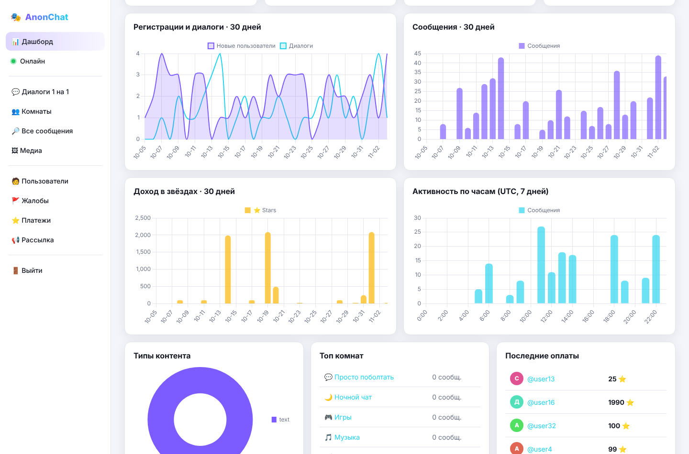
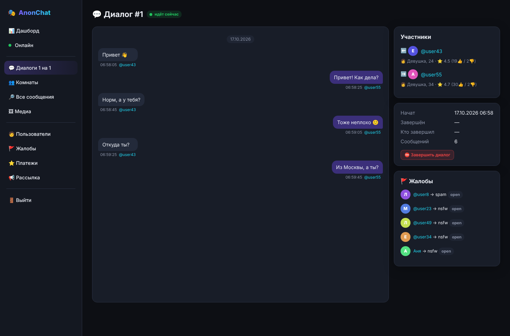
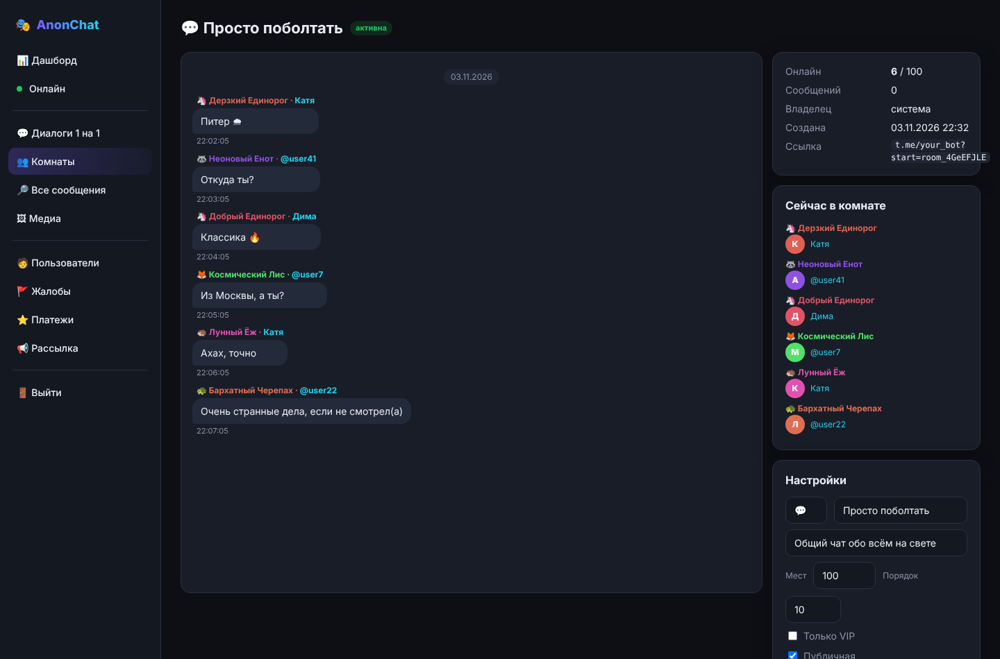
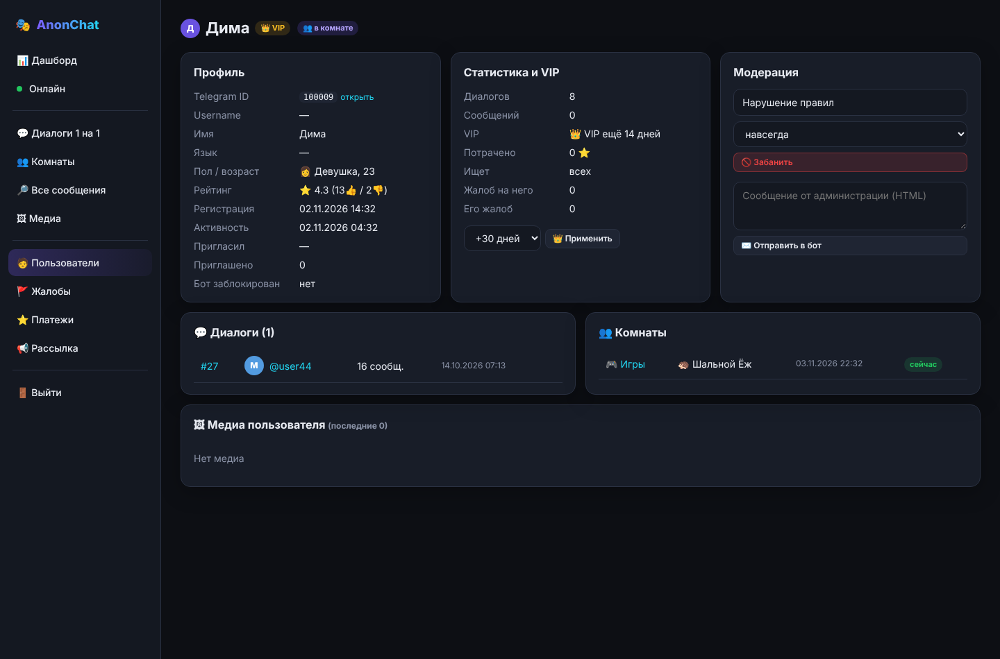

# 🎭 AnonChat — анонимный чат для Telegram + веб-админка

Telegram-бот для анонимного общения: случайный собеседник **один на один**, **групповые анонимные комнаты**,
**VIP-подписка и донаты через Telegram Stars**, модерация и **веб-панель администратора** со статистикой
и просмотром всех диалогов и медиа.

Стек: Python 3.12+, aiogram 3, FastAPI + Jinja2, SQLAlchemy (SQLite из коробки, PostgreSQL одной строкой).

---

## 🚀 Быстрый старт

1. Создай бота у [@BotFather](https://t.me/BotFather) и скопируй токен.
2. Узнай свой Telegram ID (например, через @userinfobot).
3. Настрой окружение:

```bash
cp .env.example .env      # впиши BOT_TOKEN, ADMIN_IDS, ADMIN_PASSWORD, SECRET_KEY
pip install -r requirements.txt
python main.py            # бот + админка (http://localhost:8080)
```

Или через Docker:

```bash
cp .env.example .env && nano .env
docker compose up -d --build
```

Режимы запуска: `python main.py bot` — только бот, `python main.py admin` — только админка.

Посмотреть админку без бота, на демо-данных:

```bash
DATABASE_URL=sqlite+aiosqlite:///data/demo.db python scripts/demo_data.py
DATABASE_URL=sqlite+aiosqlite:///data/demo.db python main.py admin
```

> **Важно для продакшена:** поставь админку за HTTPS (nginx/Caddy) и задай сложные `ADMIN_PASSWORD` и `SECRET_KEY`.
> Если панель доступна из интернета — ограничь доступ по IP или через VPN.

---

## 💬 Как устроен бот

### Онбординг (`/start`)
Приветствие → выбор пола (можно пропустить) → возраст (кнопками или числом, младше 16 — отказ).
Глубокие ссылки: `?start=ref_<id>` — реферал, `?start=room_<код>` — сразу войти в комнату.

### Главное меню
```
[ 🔍 Найти собеседника            ]
[ 🎯 Поиск по полу ] [ 👥 Комнаты ]
[ 👤 Профиль       ] [ 👑 VIP     ]
[ ⚙️ Настройки ] [ 💝 Поддержать ] [ ❓ Помощь ]
```
Клавиатура меняется по ситуации: во время поиска — «❌ Отменить поиск», в диалоге —
«⏭ Следующий / ⛔ Стоп / 🔗 Мой профиль / 🚩 Жалоба», в комнате — «👥 Участники / ℹ️ О комнате / 🚪 Выйти».

### Подбор собеседника 1 на 1 (`anonchat/services/matching.py`)
* Очередь хранится в БД (`users.state = searching`) и переживает перезапуск бота.
* Все операции с очередью идут под одним замком — двух людей не соединит с одним и тем же собеседником.
* **VIP идут первыми**, внутри группы — кто дольше ждёт.
* **VIP-фильтры работают в обе стороны**: если VIP-девушка ищет парней, она не попадётся другой девушке.
* **Не соединяет с прошлым собеседником** первые 30 секунд (после — можно, если больше никого нет).
* **Дизлайк = взаимный чёрный список**: эти двое больше не встретятся.
* Фоновая задача каждые 5 с пересматривает очередь.

В диалоге пересылается всё: текст, фото, видео, GIF, голосовые, кружки, стикеры, файлы, геолокация.
Через `copy_message`, поэтому нет пометки «переслано от». Работают **ответы (reply)** и **правка сообщений**:
бот хранит, какое сообщение какой копии соответствует.
После диалога — оценка 👍/👎 и жалоба. `/link` — по желанию отправить собеседнику свой @username.

### 👥 Групповые комнаты
* 8 готовых тематических комнат + 👑 VIP-лаунж (создаются при первом запуске).
* В каждой комнате у участника **случайный анонимный ник**: «🦊 Хитрый Лис», «🐼 Сонная Панда»…
* Сообщения приходят всем участникам с ником автора, ответы (reply) адресуются конкретному человеку.
* Список с онлайном и пагинацией, «🎲 Случайная комната» — самая живая со свободными местами.
* **VIP создаёт свои комнаты**: публичные или по ссылке-приглашению, 5–100 мест, владелец может `/kick`.
* Анти-спам: ссылки и @упоминания в комнатах — только для VIP. Есть общий антифлуд.

### 👑 VIP и монетизация (Telegram Stars)
Цифровые товары в ботах Telegram разрешает продавать **только за Stars** (`currency="XTR"`) — так и сделано.
Ориентир по курсу: 1 ⭐ ≈ 1,6–2 ₽ для покупателя. Продавец выводит звёзды через Fragment примерно по $0.013 за ⭐
(после 21 дня холда).

| Тариф | Цена | ≈ ₽ |
|---|---|---|
| ⚡ VIP на 1 день | 25 ⭐ | ~45 ₽ |
| 🥉 VIP на 7 дней | 99 ⭐ | ~180 ₽ |
| 🥈 VIP на 30 дней | 249 ⭐ | ~450 ₽ |
| 🥇 VIP на 90 дней | 549 ⭐ | ~990 ₽ |
| 💎 VIP навсегда | 1990 ⭐ | ~3600 ₽ |

**Донаты:** 10 / 50 / 100 / 250 / 500 / 1000 ⭐, начиная со 100 ⭐ в подарок даётся VIP (3–30 дней).
**Рефералка:** +1 день VIP за каждого приглашённого (`/invite`).
Цены и бонусы меняются в `anonchat/config.py` (`PRODUCTS`, `DONATE_AMOUNTS`, `DONATE_VIP_BONUS`).

Что даёт VIP:
* 🎯 поиск по полу и 🎂 по возрасту;
* ⚡ приоритет в очереди;
* ⭐ рейтинг собеседника виден сразу;
* 🔁 вернуть прошлого собеседника (`/reconnect`, он должен согласиться);
* 🛡 защита от пересылки и сохранения своих медиа (`protect_content`);
* 🏠 свои комнаты, 👑 VIP-лаунж, ✏️ свой ник в комнатах (`/nick`), ссылки в комнатах.

Обязательная для платёжных ботов команда `/paysupport` есть. Возврат звёзд делается из админки одной кнопкой
(`refundStarPayment`), VIP при этом списывается.

### 🛡 Модерация
* Жалобы с причинами (спам, оскорбления, 18+, несовершеннолетний, мошенничество…). Каждая жалоба сразу
  приходит админам в личку с готовой командой бана.
* Бан навсегда или на срок. Забаненного выкидывает из диалога, комнаты и очереди.
* Команды админа в боте: `/admin` (сводка), `/ban id [часы] [причина]`, `/unban id`, `/givevip id дни`.

---

## 🖥 Админ-панель

| Раздел | Что там |
|---|---|
| 📊 **Дашборд** | пользователи, DAU/WAU/MAU, онлайн, доход, VIP-конверсия, жалобы. Графики за 30 дней: регистрации, диалоги, сообщения, звёзды, активность по часам, типы контента |
| 🟢 **Онлайн** | идущие диалоги, очередь поиска, живые комнаты (автообновление) |
| 💬 **Диалоги** | все диалоги (активные и завершённые), фильтр по пользователю. Просмотр в виде переписки с фото, видео, кружками, голосовыми и стикерами. **Новые сообщения подгружаются сами.** Можно принудительно завершить диалог |
| 👥 **Комнаты** | все комнаты, переписка с никами и реальными аккаунтами авторов, кто сейчас внутри, редактирование, закрытие, создание системных комнат |
| 🔎 **Все сообщения** | поиск по тексту по всей базе, фильтр по типу |
| 🖼 **Медиа** | галерея всех фото, видео, голосовых, стикеров и файлов со ссылкой на чат |
| 🧑 **Пользователи** | поиск по ID / @username / имени, фильтры (онлайн, VIP, платившие, с жалобами, бан). Карточка: профиль, диалоги, комнаты, платежи, жалобы, медиа; бан/разбан, выдача VIP, личное сообщение от бота |
| 🚩 **Жалобы** | очередь жалоб, счётчик жалоб на человека, бан в один клик |
| ⭐ **Платежи** | доход, разбивка по тарифам, топ донатеров, история, возвраты |
| 📢 **Рассылка** | всем / не в чате / без VIP / VIP, фоновая отправка с учётом лимитов Telegram |

| | |
|---|---|
|  |  |
|  |  |

Медиа админка скачивает из Telegram по `file_id` при первом просмотре и кэширует в `data/media`.
Ограничение Bot API: файлы больше 20 МБ так скачать нельзя (в чате будет пометка).

---

## ⚖️ Конфиденциальность и закон

Бот **сохраняет все сообщения и медиа** — это нужно для модерации и работы админки. Об этом честно сказано
в `/rules`. Не убирай этот пункт: пользователи «анонимного» чата должны знать, что переписку видит модерация.
Если работаешь с пользователями из РФ или ЕС, учитывай требования к хранению персональных данных
(152-ФЗ / GDPR): политика конфиденциальности, срок хранения, удаление данных по запросу.

---

## 🗂 Структура

```
main.py                     запуск бота и админки
anonchat/
  config.py                 настройки и тарифы
  models.py                 таблицы БД
  services/                 логика: matching, rooms, messaging, users, stats
  bot/
    texts.py, keyboards.py  тексты и кнопки
    middlewares.py          регистрация, баны, антифлуд
    handlers/               start, search, rooms, vip, profile, admin, relay
  admin/
    app.py                  FastAPI-админка
    templates/, static/     интерфейс
scripts/demo_data.py        демо-данные
tests/                      тесты (pytest)
```

Тесты: `pip install pytest httpx && python -m pytest -q`

### Масштабирование
Один процесс спокойно держит тысячи пользователей онлайн. Дальше:
PostgreSQL (`DATABASE_URL=postgresql+asyncpg://…`, добавь `asyncpg` в зависимости), webhook вместо polling,
а для нескольких экземпляров бота — вынести замок очереди в Redis/`SELECT … FOR UPDATE SKIP LOCKED`.
